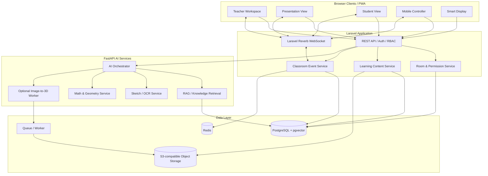
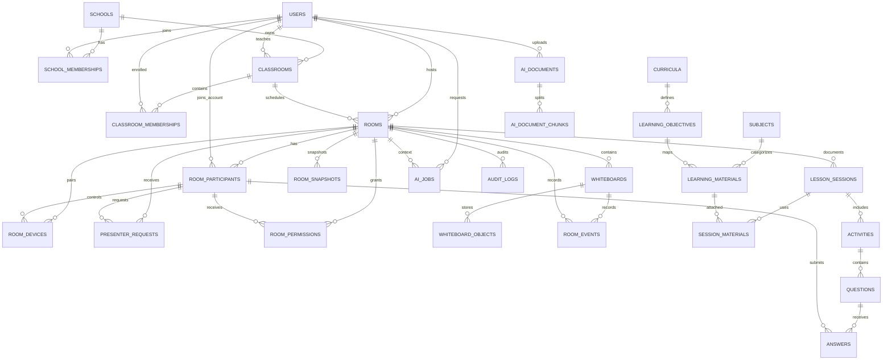
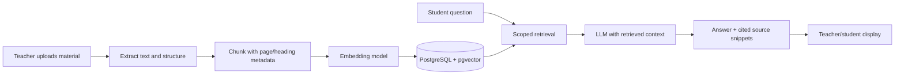

# AI INTERACTIVE CLASSROOM
## Product & Technical Specification (Tech Spec)

**Versi:** 1.0  
**Tanggal:** 21 November 2026  
**Status:** Baseline rancangan untuk validasi dan pengembangan MVP  
**Nama produk:** *AI Interactive Classroom* (nama kerja; nama merek belum ditetapkan)  
**Bahasa dokumen:** Bahasa Indonesia

> Dokumen ini mengonsolidasikan keputusan produk dari diskusi, brief referensi iFLYTEK yang diberikan pengguna, dan riset dokumentasi teknis publik. Fitur dan arsitektur di bawah merupakan rancangan produk yang diusulkan, bukan klaim bahwa semua fitur sudah dibangun atau telah diuji di sekolah.

---

## 0. Ringkasan Keputusan yang Sudah Dikunci

| Area | Keputusan |
|---|---|
| Bentuk produk | Platform web responsif/PWA; tidak membuat hardware smartboard sendiri |
| Backend utama | Laravel |
| Layanan AI/komputasi | Python + FastAPI |
| Frontend | React + TypeScript |
| Fokus mata pelajaran awal | Matematika, dimulai dari geometri dan grafik; arsitektur dapat diperluas ke materi matematika lain |
| Sketch-to-3D | Hybrid: algoritma geometri deterministik + AI untuk memahami konteks/ambiguitas |
| Perangkat | Laptop, tablet, smartphone, browser Smart TV/interactive display yang kompatibel |
| Room access | Hybrid: siswa dapat masuk sebagai guest dengan kode atau login akun |
| Hak edit siswa | Harus mendapat persetujuan guru; akses presenter bersifat sementara dan dapat dicabut |
| Classroom configuration | Adaptive Classroom: menyarankan dan mengatur tampilan sesuai perangkat/fasilitas yang dipilih atau terdeteksi secara terbatas |
| Dokumentasi | Event-based Replay: menyimpan perubahan whiteboard dan aktivitas terstruktur, bukan merekam video/audio secara default |
| Realtime | Laravel Reverb untuk event/presence pada MVP; Yjs/Hocuspocus menjadi opsi saat kolaborasi multi-editor benar-benar dibutuhkan |
| Offline | Whiteboard lokal, aset yang sudah di-cache, dan antrean sinkronisasi terbatas; AI cloud dan kolaborasi realtime tetap memerlukan internet |

### Prinsip arsitektur

**AI memahami konteks, engine deterministik menghitung, dan engine visualisasi memperlihatkan hasil.** Jangan meminta LLM menjadi satu-satunya sumber kebenaran matematika atau sains.

---

# BAGIAN I — PRODUCT SPECIFICATION

## 1. Definisi Produk

AI Interactive Classroom adalah platform pembelajaran berbasis browser yang menggabungkan whiteboard digital, visualisasi matematika interaktif 2D/3D, AI Teaching Assistant, AI Student Learning Assistant, serta room pembelajaran realtime.

Produk dirancang untuk kondisi sekolah yang fasilitasnya tidak seragam. Guru dapat mengajar menggunakan laptop dan proyektor, Smart TV touchscreen, atau smartphone. Siswa dapat mengikuti pembelajaran dari browser menggunakan akun atau guest code. Jika tidak semua siswa mempunyai perangkat, guru dapat memakai group learning atau menampilkan materi ke satu layar bersama.

Produk tidak mensyaratkan smartboard fisik. Whiteboard adalah aplikasi web yang berjalan di perangkat yang tersedia.

## 2. Latar Belakang dan Masalah yang Ingin Diselesaikan

Kondisi yang menjadi dasar desain berasal dari pengalaman dan penjelasan pengguna:

1. Sebagian kelas tidak memiliki smartboard atau interactive display.
2. Ada guru yang tidak mempunyai laptop pribadi.
3. Sebagian sekolah memiliki proyektor dan Wi-Fi, tetapi tidak semua.
4. Beberapa sekolah memiliki Smart TV touchscreen yang dapat digunakan untuk interaksi langsung.
5. Kepemilikan smartphone/laptop siswa tidak merata.
6. Menggambar dengan mouse tidak senyaman menggunakan stylus; antarmuka harus menyediakan shape builder, snapping, dan input alternatif.
7. Materi matematika, terutama geometri ruang dan grafik, sering lebih mudah dipahami melalui representasi visual yang dapat dimanipulasi.
8. Guru membutuhkan cara mengajak siswa mempraktikkan materi tanpa memberikan hak edit kepada semua peserta secara bersamaan.

Dokumen ini tidak mengasumsikan bahwa semua sekolah memiliki koneksi cepat atau bahwa semua siswa mempunyai perangkat pribadi.

## 3. Visi, Misi, dan Positioning

### Visi

Membuat pembelajaran visual dan interaktif dapat digunakan oleh sekolah dengan fasilitas yang berbeda-beda tanpa harus membeli perangkat smartboard khusus.

### Misi

- Menyediakan ruang belajar interaktif lintas perangkat.
- Membantu guru memvisualisasikan konsep yang abstrak.
- Memberikan ruang partisipasi yang terkontrol bagi siswa.
- Menggunakan AI untuk membantu persiapan, penjelasan, dan refleksi pembelajaran.
- Mengutamakan akurasi materi, aksesibilitas, privasi, dan penggunaan bandwidth yang efisien.

### Positioning

**A browser-based AI learning environment for accessible, interactive, and collaborative classrooms.**

### Nilai pembeda yang dituju

- Tidak mengharuskan sekolah memiliki smartboard fisik.
- Memiliki mode projector, smart display, mobile host, mobile controller, dan student room.
- Menggunakan model permission host/presenter/student.
- Memiliki event-based replay yang dapat merekonstruksi proses whiteboard.
- Menggabungkan geometri deterministik, model 3D edukasi tervalidasi, dan AI kontekstual.

## 4. Tujuan Produk dan Non-Goals

### Product Goals

- G1: Guru dapat memulai kelas interaktif dari perangkat yang tersedia.
- G2: Guru dapat membuat dan memanipulasi objek matematika 2D/3D.
- G3: Siswa dapat bergabung dengan akun atau guest code.
- G4: Guru dapat mengizinkan seorang siswa menjadi presenter sementara.
- G5: HP guru dapat menjadi controller untuk laptop/proyektor.
- G6: Sistem dapat menyimpan dan memutar ulang aktivitas whiteboard.
- G7: Platform tetap berguna pada jaringan terbatas melalui fitur offline terbatas.
- G8: AI memberikan penjelasan yang memiliki referensi/konteks dan dapat ditinjau guru.

### Non-Goals untuk MVP

- Membuat layar, stylus, kamera, speaker, atau hardware smartboard sendiri.
- Menggantikan guru atau mengambil keputusan pedagogis secara otomatis.
- Mengubah semua foto/coretan bebas menjadi model 3D fotorealistik.
- Menjamin seluruh fungsi AI berjalan offline.
- Merekam video dan audio kelas secara otomatis.
- Menggantikan LMS sekolah secara penuh pada rilis pertama.
- Menyediakan diagnosis psikologis atau label kemampuan permanen terhadap siswa.

## 5. Target Pengguna dan Persona

| Persona | Kebutuhan | Fitur utama |
|---|---|---|
| Guru | Menjelaskan materi dengan visual, mengontrol kelas, menilai pemahaman | Whiteboard, AI Teaching Assistant, Room, Polling, Presenter Approval |
| Siswa login | Mengikuti kelas, menyimpan progres, mengerjakan aktivitas | Student Workspace, Quiz, AI Tutor, Learning History |
| Siswa guest | Bergabung cepat tanpa membuat akun penuh | Join Code/QR, Guest Session, Quiz, Raise Hand |
| Ketua kelompok | Mengatur aktivitas kelompok | Group Workspace, Submit Result |
| Admin sekolah | Mengelola guru, kelas, dan kebijakan akses | School Dashboard, Membership, Reports |
| Admin platform | Mengelola tenant, layanan, dan keamanan | Platform Administration, Audit, Monitoring |

### Target awal

- Guru SMP, SMA, dan SMK.
- Siswa SMP, SMA, dan SMK.
- Guru matematika sebagai pengguna awal.
- Sekolah yang memiliki setidaknya satu perangkat guru atau perangkat kelompok dan akses internet sesekali.

## 6. Adaptive Classroom: Mode dan Aturan Perangkat

Adaptive Classroom berarti sistem menampilkan workflow dan kontrol yang sesuai dengan perangkat/fasilitas yang dipilih. Browser **tidak dapat secara andal mengetahui** apakah ruangan memiliki proyektor atau apakah layar eksternal benar-benar terpasang. Karena itu, konfigurasi fasilitas harus dikonfirmasi guru melalui quick setup; deteksi browser hanya membantu mengetahui kapabilitas input, ukuran layar, dan dukungan fitur.

### 6.1 Mode A — Projector Mode

**Konfigurasi:** laptop guru + proyektor/layar eksternal; siswa boleh bergabung melalui HP/laptop.

- Teacher View: kontrol lengkap, peserta, materi, AI, dan permission.
- Presentation View: layar bersih untuk diproyeksikan, tanpa sidebar administrasi.
- Siswa melihat state presentasi yang sama pada perangkat masing-masing jika mereka bergabung.
- Guru dapat menghubungkan HP sebagai Mobile Controller.

### 6.2 Mode B — Smart Display Mode

**Konfigurasi:** Smart TV/interactive display dengan browser dan touchscreen yang kompatibel.

- Touch-first toolbar dengan tombol besar.
- Mendukung Pointer Events untuk mouse, pen, dan touch.
- Guru dapat menggambar langsung pada layar.
- Siswa dapat meminta Presenter Access.
- Kompatibilitas browser Smart TV perlu diuji; jangan menganggap setiap Smart TV mendukung WebGL atau browser modern.

### 6.3 Mode C — Mobile Host Mode

**Konfigurasi:** guru hanya mempunyai smartphone.

- Guru membuat Instant Room dari HP.
- Guru dapat membagikan link, kode, atau QR.
- Siswa bergabung melalui HP/laptop.
- Guru memakai kontrol sederhana: materi, slide, objek, quick quiz, polling, dan permission.
- Jika tidak ada layar bersama, setiap siswa/kelompok melihat visualisasi pada perangkat masing-masing.
- Jika hanya guru yang memiliki HP dan tidak tersedia layar atau perangkat siswa, platform tidak dapat menampilkan visualisasi 3D ke seluruh kelas secara bersamaan; guru dapat memakai materi yang sudah dicetak atau aktivitas lisan/kelompok.

### 6.4 Mode D — Mobile Controller Mode

**Konfigurasi:** laptop guru terhubung ke proyektor, HP guru dipasangkan melalui QR.

- Laptop menjadi Presentation Host.
- HP menjadi Remote Controller, bukan mirror/screen-streaming.
- HP mengirim perintah drawing, pointer, annotation, object manipulation, zoom, slide navigation, dan 3D controls.
- State disinkronkan melalui server realtime.
- Pairing token terpisah dari room code, memiliki scope, TTL, dan dapat dicabut.

### 6.5 Mode E — Student Room / Group Learning

**Konfigurasi:** siswa bergabung melalui perangkat pribadi atau perangkat kelompok.

- Follow Teacher: siswa mengikuti halaman/objek/scene yang dipilih guru.
- Independent View: siswa dapat memutar atau mengeksplorasi model secara individual tanpa mengubah state guru.
- Group Workspace: kelompok mempunyai ruang kerja sendiri.
- Group Leader dapat mengirim hasil kepada guru.
- Jika perangkat terbatas, satu perangkat dapat digunakan per kelompok.

### 6.6 Quick Setup Adaptive Classroom

1. Guru memilih fasilitas: laptop/proyektor, smart display, smartphone, atau perangkat kelompok.
2. Browser melaporkan kapabilitas yang relevan: viewport, touch support, WebGL availability, pointer type, dan koneksi (indikator kasar).
3. Sistem merekomendasikan mode.
4. Guru mengonfirmasi konfigurasi.
5. Sistem membuka interface yang sesuai.
6. Guru dapat mengganti mode kapan saja selama sesi jika workflow mengizinkan.

## 7. Room Lifecycle dan Akses

### 7.1 Status Room

`draft -> scheduled (optional) -> lobby -> live -> ended -> archived`

- Draft: room disiapkan, belum dapat diakses siswa.
- Scheduled: room dijadwalkan.
- Lobby: room dibuka, peserta dapat masuk.
- Live: pembelajaran sedang berlangsung.
- Ended: host menutup sesi; akses edit dicabut.
- Archived: sesi dan event replay disimpan sesuai retention policy.

### 7.2 Metode Join

**Guest join**

- Siswa membuka URL atau memindai QR.
- Memasukkan room code jika belum ada pada URL.
- Memilih nama tampilan/alias sesuai kebijakan sekolah.
- Server menerbitkan guest session token yang singkat masa berlakunya.
- Guest dapat melihat materi dan berpartisipasi sesuai permission.
- Guest join tidak berarti data menjadi anonim sepenuhnya: IP, metadata perangkat, dan nama tampilan masih dapat menjadi data pribadi. Kumpulkan seminimal mungkin.

**Account join**

- Siswa login.
- Server memeriksa keanggotaan kelas atau invitation.
- Identitas dapat ditampilkan kepada guru sesuai kebijakan sekolah.

### 7.3 Aturan Room Code

- Kode room harus memiliki entropy yang memadai dan tidak menjadi satu-satunya faktor otorisasi.
- Batasi percobaan join, terapkan rate limit, expiry, dan kemampuan regenerate/close code.
- Guest token harus scoped ke satu room dan satu participant.
- Kode room tidak boleh digunakan sebagai token Mobile Controller.

## 8. Roles, Permissions, dan Presenter Workflow

### 8.1 Peran

- `platform_admin`: pengelola sistem platform.
- `school_admin`: pengelola sekolah/tenant.
- `teacher_host`: pemilik dan pengendali room.
- `co_teacher`: opsional, ditambahkan pada fase lanjutan.
- `presenter`: peran sementara yang diberikan setelah persetujuan host.
- `student`: peserta terdaftar.
- `guest_student`: peserta sesi tanpa akun.
- `group_leader`: siswa yang dapat mengelola submit kelompok.

### 8.2 Permission Matrix

| Aksi | Host | Presenter aktif | Student/Guest | Group Leader |
|---|---:|---:|---:|---:|
| Melihat presentation | Ya | Ya | Ya | Ya |
| Mengubah master whiteboard | Ya | Ya, jika diberi izin | Tidak | Tidak |
| Menggambar di workspace kelompok | Ya | Ya | Sesuai kebijakan | Ya |
| Raise Hand | N/A | N/A | Ya | Ya |
| Approve presenter | Ya | Tidak | Tidak | Tidak |
| Cabut presenter access | Ya | Tidak | Tidak | Tidak |
| Mengelola peserta | Ya | Tidak | Tidak | Hanya anggota kelompok |
| Mengakhiri room | Ya | Tidak | Tidak | Tidak |
| Melihat jawaban individual | Ya | Tidak | Milik sendiri | Jawaban kelompok |

### 8.3 Presenter State Machine

`idle -> requested -> approved -> active -> revoked/expired`

- Siswa menekan Raise Hand atau Request Presenter.
- Permintaan masuk ke daftar host.
- Host menyetujui atau menolak.
- Jika disetujui, host menentukan scope: `draw_only`, `object_edit`, atau `full_board`.
- Izin memiliki expiry atau berakhir saat host mencabutnya.
- Perubahan permission segera dikirim ke semua perangkat.
- Server memvalidasi role setiap event; UI hide/disable bukan kontrol keamanan.
- MVP sebaiknya satu presenter aktif untuk master whiteboard pada satu waktu. Banyak siswa tetap dapat bekerja paralel pada group workspace terpisah.

## 9. Modul dan Spesifikasi Fitur

### 9.1 Teacher Workspace

- Dashboard kelas dan materi.
- Membuat Instant Room atau Scheduled Room.
- Memilih mata pelajaran, topik, dan tujuan pembelajaran.
- Membuka Whiteboard.
- Mengelola peserta, permission, dan pairing HP.
- Membuka kuis/polling.
- Menutup room dan melihat replay.

### 9.2 AI Smart Whiteboard

Tools:

- Select, Pen, Eraser, Shapes, Line, Arrow, Text, Ruler.
- Undo/Redo.
- Zoom/Pan.
- Layers dan grouping.
- Grid/snap/alignment.
- Shape Builder untuk penggunaan mouse.
- Free Draw untuk touch/stylus.
- Export image/PDF.
- Save/load scene.

**Prinsip input:** gunakan Pointer Events untuk menggabungkan mouse, touch, dan stylus. Jangan mengasumsikan tekanan stylus tersedia; `pressure` bisa tidak didukung atau bernilai default. Untuk mouse, sediakan click-to-create shape, drag-to-resize, keyboard shortcuts, snapping, dan numeric inputs.

### 9.3 Sketch Recognition dan Sketch-to-3D

Pipeline yang diusulkan:

1. Capture stroke sebagai titik koordinat, pointer type, timestamp, dan pressure bila tersedia.
2. Normalisasi koordinat terhadap canvas.
3. Segmentasi stroke dan ekstraksi fitur dasar.
4. Klasifikasi bentuk/primitive menggunakan aturan geometri dan model ringan bila diperlukan.
5. Hitung confidence.
6. Jika confidence rendah, tampilkan pilihan klarifikasi kepada guru (misalnya “kubus / balok / sketsa bebas?”).
7. Buat representasi parametrik (`shape_type`, ukuran, posisi, rotasi, label, metadata matematika).
8. Render model menggunakan Three.js.
9. AI menghubungkan model dengan topik dan memberikan penjelasan; parameter numerik tetap dihitung oleh geometry/math engine.

**Batasan:** gambar 2D biasa tidak selalu cukup untuk mengembalikan objek 3D yang unik. Untuk bangun ruang, bentuk dengan garis perspektif atau Shape Builder lebih dapat diandalkan. Image-to-3D generatif menjadi fitur eksperimen, bukan mekanisme utama untuk kubus/limas/prisma yang membutuhkan akurasi matematis.

### 9.4 Mathematical Learning Engine

Domain awal:

- Geometri bidang dan ruang.
- Pengukuran, keliling, luas, volume, luas permukaan.
- Koordinat dan grafik fungsi.
- Persamaan dan pertidaksamaan dasar.

Roadmap domain matematika berikutnya:

- Aritmetika dan rasio.
- Aljabar.
- Fungsi dan relasi.
- Trigonometri.
- Statistika dan peluang.
- Kalkulus dasar jika sesuai jenjang dan kebutuhan.

Komponen:

- Math input: MathLive.
- Render notation: MathJax atau KaTeX (pilih satu pada implementasi).
- Compute/evaluation: mathjs atau symbolic engine yang tervalidasi; batasi fungsi dan evaluasi ekspresi sebagai AST aman.
- Graphing: Three.js untuk grafik 3D dan library 2D yang dipilih setelah benchmark; jangan hardcode fungsi matematika ke dalam LLM.
- Geometry engine: implementasi parametrik sendiri untuk primitive dan rumus yang diuji.

### 9.5 AI Teaching Assistant

- Membuat lesson outline.
- Menghasilkan penjelasan bertingkat.
- Menyusun pertanyaan pembuka dan latihan.
- Menghasilkan kuis dari materi guru.
- Menyarankan visualisasi yang relevan.
- Merangkum materi.
- Menyusun draft worksheet.
- Semua konten AI harus dapat diedit dan disetujui guru sebelum dibagikan.

### 9.6 AI Student Learning Assistant

- Tanya jawab berdasarkan materi kelas (RAG).
- Penjelasan bertahap dan petunjuk belajar.
- Latihan soal dengan feedback.
- Link ke visualisasi objek.
- Riwayat materi dan tujuan belajar.
- Tidak selalu memberikan jawaban akhir; guru dapat mengatur mode hint-first.

### 9.7 Classroom Collaboration

- Room code dan QR join.
- Follow Teacher / Independent View.
- Raise Hand.
- Presenter Approval.
- Group Workspace.
- Quick Poll dan Quiz.
- Teacher Dashboard untuk memantau respons.
- Mobile Controller pairing.

### 9.8 Classroom Tools

- Attendance check-in opsional.
- Timer.
- Random Student Picker.
- Group Generator.
- Exit Ticket.
- Flashcard generator.
- Assignment and submission.
- Student answer gallery dengan anonimisasi saat ditampilkan ke proyektor.

### 9.9 Event-based Replay

MVP merekam event terstruktur:

- Objek dibuat/diubah/dihapus.
- Stroke/annotation selesai.
- Scene/slide aktif berubah.
- Nilai parameter visualisasi berubah.
- Poll/quiz dibuka dan ditutup.
- Presenter permission berubah.
- Submission terkirim.

Tidak perlu menyimpan setiap gerakan cursor atau pointer preview. Event yang terlalu granular dapat dikelompokkan menjadi satu stroke atau transform final.

Replay dapat memperlihatkan:

- Timeline.
- Play/pause/speed.
- Langkah sebelumnya/berikutnya.
- Restore snapshot.
- Highlight event penting.

Event-based replay bukan pengganti video/audio recording. Video/audio recording tidak termasuk MVP dan memerlukan persetujuan, kebijakan retensi, dan desain privasi terpisah.

## 10. Functional Requirements

| ID | Requirement | Acceptance criteria |
|---|---|---|
| FR-001 | Guru dapat membuat Instant Room | Room memiliki kode unik, QR, status lobby, dan expiry |
| FR-002 | Siswa dapat join sebagai guest | Guest menerima identitas sesi dan hanya dapat masuk room yang valid |
| FR-003 | Siswa dapat join dengan akun | Backend memverifikasi status akun dan membership |
| FR-004 | Guru dapat membuka Presentation View | Tampilan fullscreen bersih, terpisah dari dashboard guru |
| FR-005 | Guru dapat menggambar lintas input | Mouse, touch, stylus dikenali melalui Pointer Events |
| FR-006 | Shape Builder tersedia | Pengguna dapat membuat dan mengubah bentuk tanpa freehand |
| FR-007 | Sistem menampilkan geometri 3D | Primitive dapat diputar, di-zoom, dan diubah parameternya |
| FR-008 | Guru dapat memasangkan HP | QR pairing menerbitkan token controller terpisah dan dapat dicabut |
| FR-009 | Siswa dapat Raise Hand | Permintaan muncul pada dashboard host |
| FR-010 | Host menyetujui presenter | Permission scoped dan temporary diterapkan server-side |
| FR-011 | Siswa mengikuti mode tampilan | Follow Teacher dan Independent View bekerja sesuai spesifikasi |
| FR-012 | Guru dapat membuat polling/kuis | Respons disimpan dan ditampilkan pada dashboard |
| FR-013 | Replay aktivitas tersedia | Sistem merekonstruksi state dari snapshot dan event berurutan |
| FR-014 | Whiteboard dapat dipakai offline terbatas | Perubahan lokal dapat tersimpan dan antre untuk sinkronisasi |
| FR-015 | AI memberi penjelasan materi | Respons mengandung referensi konteks bila menggunakan dokumen RAG |
| FR-016 | Guru dapat mengakhiri room | Semua token presenter/controller dan akses edit dicabut |

## 11. Non-Functional Requirements

| ID | Area | Target desain awal |
|---|---|---|
| NFR-001 | Responsive | Layout usable pada viewport mobile, tablet, laptop, display besar |
| NFR-002 | Realtime | Event board normal terasa responsif; target awal p95 < 500 ms pada jaringan uji yang memadai, bukan SLA publik |
| NFR-003 | Reliability | Reconnect dan resync setelah koneksi terputus |
| NFR-004 | Offline | Whiteboard dan aset cached yang diizinkan tetap dapat dibuka tanpa internet |
| NFR-005 | Performance | Model 3D memiliki level-of-detail/quality setting dan lazy loading |
| NFR-006 | Security | Server-side authorization pada setiap operasi penting |
| NFR-007 | Privacy | Data minimization, retention policy, access log, no default video/audio recording |
| NFR-008 | Accessibility | Keyboard support, visible focus, contrast, labels, touch target memadai |
| NFR-009 | Maintainability | API versioning, test coverage, typed event schema |
| NFR-010 | Observability | Structured logs, metrics, error tracking, AI usage/cost tracking |

Target angka adalah sasaran pengujian MVP yang perlu diverifikasi dengan perangkat dan jaringan pilot, bukan klaim performa yang sudah tercapai.

---

# BAGIAN II — TECHNICAL ARCHITECTURE

## 12. High-level Architecture



### Rekomendasi boundary layanan

**Laravel (core application)**

- Authentication/session.
- School/tenant, user, classroom, membership.
- Room lifecycle, room code, role and permission.
- REST API untuk konten, aktivitas, hasil belajar.
- Realtime broadcasting via Reverb.
- Persistensi event dan replay metadata.
- Queue orchestration untuk job AI.

**FastAPI (AI/compute services)**

- AI orchestration.
- Document ingestion dan embedding.
- RAG retrieval dan generation.
- Sketch classification / geometric interpretation.
- Math and geometry helper endpoints.
- Worker untuk model image-to-3D eksperimen.

**Frontend (React + TypeScript)**

- Teacher, student, projector, controller, display interfaces.
- Drawing engine.
- Three.js viewer.
- PWA and IndexedDB.
- Client-side event queue.

### Real-time decision

Untuk MVP, mulai dengan Laravel Reverb + Laravel broadcasting + Laravel Echo. Gunakan Reverb untuk room presence, event broadcast, participant updates, presenter requests, quiz/poll updates, dan state changes.

Gunakan server-authoritative event model untuk master whiteboard: host/presenter mengirim command, server memvalidasi permission, menyimpan event, memberi sequence number, lalu broadcast ke peserta.

Tambahkan Yjs + Hocuspocus hanya saat kebutuhan kolaborasi multi-editor pada satu canvas menjadi nyata. Memakai Reverb dan Yjs bersamaan sejak awal akan menambah dua model sinkronisasi yang harus dipelihara.

## 13. Proposed Monorepo Structure

```text
ai-interactive-classroom/
├── apps/
│   ├── web/                       # React + TypeScript + PWA
│   │   ├── src/app/
│   │   ├── src/features/
│   │   │   ├── teacher/
│   │   │   ├── student/
│   │   │   ├── projector/
│   │   │   ├── mobile-controller/
│   │   │   ├── classroom-room/
│   │   │   ├── whiteboard/
│   │   │   ├── visualization/
│   │   │   └── replay/
│   │   ├── src/shared/
│   │   └── public/
│   ├── api/                       # Laravel
│   │   ├── app/Domain/
│   │   │   ├── Identity/
│   │   │   ├── Schools/
│   │   │   ├── Classrooms/
│   │   │   ├── Rooms/
│   │   │   ├── Whiteboards/
│   │   │   ├── Learning/
│   │   │   └── Replay/
│   │   ├── app/Events/
│   │   ├── routes/
│   │   └── database/migrations/
│   └── ai-service/                # FastAPI
│       ├── app/api/
│       ├── app/services/
│       │   ├── llm/
│       │   ├── rag/
│       │   ├── sketch/
│       │   ├── geometry/
│       │   ├── math/
│       │   └── image_to_3d/
│       ├── app/schemas/
│       └── tests/
├── packages/
│   ├── shared-types/              # API/event schemas
│   ├── whiteboard-core/           # Typed board objects/events
│   ├── geometry-core/             # Parametric geometry
│   └── curriculum-schema/
├── infra/
│   ├── docker/
│   ├── nginx/
│   └── monitoring/
├── docs/
│   ├── adr/
│   ├── api/
│   └── security/
├── .env.example
└── README.md
```

## 14. Technology Selection and Repository Foundation

Repos below were checked as public repositories on GitHub on 21 November 2026. License labels are based on the repository license/documentation pages linked below. License of each dependency, model checkpoint, dataset, font, icon, and external asset must still be checked before release. This list is a starting point, not legal advice.

### 14.1 Recommended Core

| Technology / Repository | Proposed use | License / note | Decision |
|---|---|---|---|
| [React Konva](https://github.com/konvajs/react-konva) | React canvas objects, selection, transform, drawing | MIT | Core candidate [S01] |
| [Konva](https://github.com/konvajs/konva) | 2D scene graph below React Konva | MIT | Core dependency [S02] |
| [Three.js](https://github.com/mrdoob/three.js) | 3D geometry, camera, controls, GLTF assets | MIT | Core [S03] |
| [MathLive](https://github.com/arnog/mathlive) | Equation input and virtual math keyboard | MIT | Core candidate [S04] |
| [mathjs](https://github.com/josdejong/mathjs) | Numeric expression evaluation and matrix utilities | Apache-2.0; review bundled component notices | Candidate [S05] |
| [Laravel Reverb](https://github.com/laravel/reverb) | WebSocket realtime for room events | MIT | Core realtime [S06] |
| [pgvector](https://github.com/pgvector/pgvector) | Store/search embeddings in PostgreSQL | PostgreSQL License | Core RAG candidate [S07] |
| [Workbox](https://github.com/GoogleChrome/workbox) | Service worker and PWA caching strategies | MIT | Core PWA candidate [S08] |

### 14.2 Optional / Later-stage Collaboration

| Technology / Repository | Proposed use | License / note | Decision |
|---|---|---|---|
| [Yjs](https://github.com/yjs/yjs) | CRDT shared document state, offline merge, undo/redo | MIT | Phase 2, only if multi-editor needed [S09] |
| [Hocuspocus](https://github.com/ueberdosis/hocuspocus) | WebSocket backend for Yjs | MIT | Pair with Yjs if selected [S10] |
| [Excalidraw](https://github.com/excalidraw/excalidraw) | Whiteboard UX and interaction reference; optional integration study | MIT | Reference, not required runtime dependency [S11] |
| [Tesseract OCR](https://github.com/tesseract-ocr/tesseract) | OCR of printed text in uploaded images/documents | Apache-2.0; not a handwriting-first solution | Optional document OCR; not for freehand math [S12] |

### 14.3 Scientific / 3D / Generative Candidates

| Technology / Repository | Proposed use | License / note | Decision |
|---|---|---|---|
| [Mol*](https://github.com/molstar/molstar) | Protein/macromolecule 3D visualization | MIT | Later biology/chemistry module [S13] |
| [3Dmol.js](https://github.com/3dmol/3Dmol.js) | Molecular formats and interactive molecular rendering | BSD-3-Clause | Alternative/companion; preserve notices [S14] |
| [TripoSR](https://github.com/VAST-AI-Research/TripoSR) | Experimental single-image-to-3D worker | MIT in official repo; needs GPU evaluation | Research feature only [S15] |

### 14.4 Tools / Licenses to Treat Carefully

- **tldraw SDK:** source-available does not mean permissive open source. Its production use requires an applicable license (trial, commercial, or eligible hobby license). Do not select it for a commercial production deployment without checking current licensing and pricing. [S16]
- **PhET simulations:** regular HTML simulations use CC BY-NC 4.0; commercial use, including use inside paid/subscription products, requires a commercial license. Use as inspiration or link externally unless permission is secured. [S17]
- **OpenStax textbooks:** CC BY-NC-SA 4.0. Do not bundle/repackage into a commercial product without permission; preserve attribution and share-alike terms where applicable. [S18]
- **RCSB PDB data:** PDB archive data and programmatic API data are generally CC0, except integrated external resources may have different terms. Attribute source authors where feasible and check each external resource. [S19]
- **Tesseract:** its own FAQ says handwriting recognition may not work well because it is designed for printed text. Do not use it as the core handwriting/math recognizer. [S20]

### 14.5 Implementation Recommendation

1. Whiteboard: React Konva + Konva.
2. 3D: Three.js.
3. Math input: MathLive; calculation with mathjs or another vetted math engine.
4. Realtime MVP: Laravel Reverb.
5. Offline: Workbox + IndexedDB/Cache API.
6. RAG: PostgreSQL + pgvector.
7. Sketch-to-3D: deterministic shape recognition and parametric geometry first; TripoSR is a separate experimental worker.
8. Molecular visualization later: Mol* or 3Dmol.js after selecting educational datasets and reviewing licenses.

## 15. ERD — Entity Relationship Model

### 15.1 ERD (Mermaid)



### 15.2 Table Definitions

**Identity and school tenancy**

| Table | Important columns | Notes |
|---|---|---|
| `users` | id, name, email, password_hash, status, created_at | Account identity; email may be optional only if auth design allows |
| `schools` | id, name, code, status, settings_json | Tenant/school |
| `school_memberships` | id, school_id, user_id, role, status | Unique `(school_id,user_id)` |
| `classrooms` | id, school_id, name, grade_label, academic_year, teacher_id, status | Classroom roster container |
| `classroom_memberships` | id, classroom_id, user_id, role, status | Unique `(classroom_id,user_id)` |
| `subjects` | id, code, name, active | Math, Biology, etc. |
| `curricula` | id, name, version, jurisdiction, effective_from, source_url | Versioned curriculum reference |
| `learning_objectives` | id, curriculum_id, subject_id, phase, code, description, metadata_json | Configurable CP/TP mapping |

**Learning content and assets**

| Table | Important columns | Notes |
|---|---|---|
| `learning_materials` | id, school_id nullable, owner_user_id, subject_id, objective_id nullable, title, body_json, visibility, status | Source or generated material |
| `material_sources` | id, material_id, source_title, source_url, license, attribution_text, accessed_at | Track provenance and license |
| `assets` | id, owner_scope, storage_key, mime_type, size_bytes, checksum, license_id nullable, metadata_json | Images, PDF, GLB/GLTF, SVG |
| `asset_licenses` | id, name, url, commercial_allowed, attribution_required, notes | Asset-level license tracking |

**Room and realtime collaboration**

| Table | Important columns | Notes |
|---|---|---|
| `rooms` | id, school_id, classroom_id nullable, host_user_id, title, room_code_hash, status, mode, settings_json, starts_at, ends_at, expires_at | Store hash of join code, not plaintext |
| `room_participants` | id, room_id, user_id nullable, guest_alias, participant_token_hash, role, status, joined_at, left_at | Account or guest session |
| `room_devices` | id, room_id, participant_id, device_type, device_label, pairing_token_hash, scope, expires_at, revoked_at | Mobile controller pairing |
| `presenter_requests` | id, room_id, participant_id, requested_scope, status, requested_at, reviewed_by, reviewed_at, expires_at | Request/approval workflow |
| `room_permissions` | id, room_id, participant_id, permission, granted_by, starts_at, expires_at, revoked_at | Temporary server-enforced permission |
| `whiteboards` | id, room_id, owner_user_id, title, board_state_json, state_version | Board metadata and current state |
| `whiteboard_objects` | id, whiteboard_id, object_key, object_type, object_json, z_index, version | Optional indexed object projection; event log is source for replay |
| `room_events` | id, room_id, whiteboard_id nullable, seq, event_type, actor_participant_id, payload_json, schema_version, idempotency_key, created_at | Append-only ordered event stream |
| `room_snapshots` | id, room_id, seq, state_json, schema_version, created_at | State checkpoint for replay/resync |

**Learning activity and assessment**

| Table | Important columns | Notes |
|---|---|---|
| `lesson_sessions` | id, room_id, title, subject_id, objective_id, started_at, ended_at, summary_json | One room may correspond to one session |
| `session_materials` | id, lesson_session_id, learning_material_id, position | Session materials |
| `activities` | id, lesson_session_id, activity_type, title, settings_json, status | Poll, quiz, exit ticket, attendance |
| `questions` | id, activity_id, question_type, prompt_json, answer_key_json, points | Avoid exposing answer key to student API |
| `answers` | id, question_id, participant_id, response_json, score, feedback_json, submitted_at | Guest answers tied to session participant |
| `learning_progress` | id, user_id, objective_id, mastery_state, evidence_json, updated_at | Phase 2; do not overstate mastery from sparse data |

**AI knowledge and operations**

| Table | Important columns | Notes |
|---|---|---|
| `ai_documents` | id, school_id nullable, owner_user_id, title, source_asset_id, status, visibility, checksum | Teacher uploaded documents |
| `ai_document_chunks` | id, document_id, chunk_index, text, embedding, page_number, metadata_json | pgvector embedding and citations |
| `ai_jobs` | id, requested_by, room_id nullable, job_type, status, input_json, output_json, error_code, token_usage, created_at | AI work and cost records |
| `audit_logs` | id, school_id nullable, actor_user_id nullable, room_id nullable, action, target_type, target_id, metadata_json, created_at | Security and admin audit |

### 15.3 Important Constraints and Indexes

- Unique `schools.code`.
- Unique `school_memberships(school_id,user_id)`.
- Unique `classroom_memberships(classroom_id,user_id)`.
- Index `rooms(status, expires_at)` and `rooms(school_id, created_at)`.
- Unique active room code hash; generate high-entropy random code.
- Unique `room_events(room_id, seq)`.
- Unique `room_events(room_id, idempotency_key)` where non-null.
- Index `room_events(room_id, created_at)`.
- Unique `room_devices(pairing_token_hash)`.
- Vector index on `ai_document_chunks.embedding` after embedding model/dimension chosen.
- Use soft-delete only where recovery is justified; retention and erasure need explicit policy.

### 15.4 Guest Data Model Notes

Guest participants are room-session identities, not permanent accounts. A guest can use a session alias and opaque participant ID. Do not collect full name, phone, email, birth date, or location unless the use case requires it and appropriate notice/consent exists. When guest work is retained for replay/assessment, define retention period and access rules.

## 16. Event-based Replay Design

### 16.1 Event Envelope

```json
{
  "event_id": "uuid",
  "room_id": "uuid",
  "whiteboard_id": "uuid",
  "seq": 42,
  "type": "whiteboard.object.updated",
  "schema_version": 1,
  "actor_participant_id": "uuid",
  "idempotency_key": "uuid",
  "occurred_at": "2026-11-21T10:00:00+07:00",
  "payload": {
    "object_id": "cube-01",
    "patch": {
      "side_length": 5,
      "unit": "cm"
    }
  }
}
```

### 16.2 Event Type Examples

- `room.started`, `room.ended`
- `whiteboard.stroke.committed`
- `whiteboard.object.created`, `whiteboard.object.updated`, `whiteboard.object.deleted`
- `whiteboard.scene.changed`
- `visualization.parameter.changed`
- `presenter.requested`, `presenter.approved`, `presenter.revoked`
- `poll.started`, `poll.response.submitted`, `poll.ended`
- `quiz.started`, `quiz.answer.submitted`, `quiz.ended`
- `group.submission.created`

### 16.3 Snapshot and Replay

- Server assigns monotonically increasing `seq` within a room.
- Persist event before broadcasting success acknowledgement.
- Use client idempotency key to prevent duplicate events after reconnect.
- Create snapshots after a configurable threshold (example: every 50 committed events or 30 seconds of active changes; tune after profiling).
- Replay loads nearest snapshot at/before target sequence, then applies events in order.
- Store `schema_version`; write migration/compatibility code when event schema changes.
- Ephemeral cursor/pointer movement can be broadcast but should not be persisted by default.
- A committed freehand stroke may be one event containing normalized points, not hundreds of raw pointer events.

## 17. API Specification (Proposed)

Base path: `/api/v1`

**Auth and user**

- `POST /auth/login`
- `POST /auth/logout`
- `GET /me`
- `GET /schools/{schoolId}/memberships`

**Room**

- `POST /rooms` — create room.
- `POST /rooms/{roomId}/start` — lobby to live.
- `POST /rooms/{roomId}/end` — end room.
- `POST /rooms/join` — join with code/guest/account.
- `GET /rooms/{roomId}` — room metadata after authorization.
- `GET /rooms/{roomId}/participants` — host view.
- `POST /rooms/{roomId}/devices/pair` — issue controller pairing.
- `POST /rooms/{roomId}/devices/confirm` — consume pairing invitation.
- `DELETE /rooms/{roomId}/devices/{deviceId}` — revoke device.

**Presenter permissions**

- `POST /rooms/{roomId}/presenter-requests`
- `POST /rooms/{roomId}/presenter-requests/{requestId}/approve`
- `POST /rooms/{roomId}/presenter-requests/{requestId}/reject`
- `DELETE /rooms/{roomId}/presenter-permissions/{permissionId}`

**Whiteboard and replay**

- `GET /rooms/{roomId}/whiteboards/{boardId}`
- `POST /rooms/{roomId}/whiteboards/{boardId}/events`
- `GET /rooms/{roomId}/events?afterSeq={n}`
- `GET /rooms/{roomId}/snapshots/latest`
- `GET /rooms/{roomId}/replay`

**Learning / assessment**

- `POST /rooms/{roomId}/activities`
- `POST /activities/{activityId}/responses`
- `GET /activities/{activityId}/results` — host only.
- `POST /rooms/{roomId}/groups`
- `POST /groups/{groupId}/submissions`

**AI**

- `POST /ai/explain-object`
- `POST /ai/generate-lesson-outline`
- `POST /ai/generate-quiz`
- `POST /ai/recognize-sketch`
- `POST /ai/solve-or-explain-math`
- `POST /ai/ingest-document`

Long-running AI jobs should return `202 Accepted` + `job_id`, then poll or subscribe to job updates. Do not block the room's realtime thread while generating a 3D asset.

## 18. Realtime Event Contract

Suggested channels:

- `private-room.{roomId}` — authorized room participants.
- `private-room.{roomId}.host` — host-only dashboard events.
- `private-room.{roomId}.presenter` — active presenter events.
- `private-room.{roomId}.group.{groupId}` — group-only workspace.
- `private-device.{deviceId}` — paired controller session.

Events:

- `RoomParticipantJoined`
- `RoomParticipantLeft`
- `RoomStateChanged`
- `WhiteboardEventCommitted`
- `PresentationStateChanged`
- `PresenterRequestCreated`
- `PresenterPermissionChanged`
- `DevicePaired`
- `PollResponseReceived`
- `QuizResponseReceived`

Every mutating event must pass authorization and schema validation server-side. Host actions can override presenter state. Client timestamps are informational; server sequence controls ordering.

## 19. AI Architecture and Knowledge System

### 19.1 Hybrid Intelligence

- LLM: interpret teacher intent, explain concepts, generate teaching material drafts.
- RAG: retrieve from teacher documents and approved curriculum references.
- Geometry engine: exact primitive geometry and formulas.
- Math engine: evaluate supported expressions and parameterized functions.
- Vision/sketch model: optional recognition for ambiguous or nonstandard strokes.
- 3D renderer: render structured objects with Three.js.

### 19.2 Sketch-to-3D Example: Cube

1. User chooses Cube Builder or draws a box-like sketch.
2. Stroke engine extracts lines and corners.
3. Shape classifier suggests cube/cuboid with confidence.
4. User confirms if ambiguous.
5. Geometry service creates a parametric cube with side length.
6. Three.js renders the model.
7. AI generates a grade-appropriate explanation based on selected curriculum/material.
8. Student interactions can rotate the model or change side length in Independent View.

### 19.3 Accuracy Strategy

- Do not use generative 3D for mathematically exact geometry.
- Use parametrically defined solids and tested formulas.
- AI explanations must distinguish between source-backed facts and generated wording.
- Show source material/page citations when RAG is used.
- Mark uncertain sketch recognition and ask the teacher to confirm.
- For biology/chemistry assets, use vetted scientific datasets/models and asset licensing records.

### 19.4 RAG Pipeline



Scope retrieval by school, classroom, lesson, visibility, and document permission. Never retrieve a private teacher document for an unrelated room.

## 20. Offline and Low-bandwidth Strategy

- PWA installability and service worker caching.
- IndexedDB for draft boards, local event queue, and recently used metadata.
- Cache small geometry primitives and selected GLB assets.
- Lazy-load Three.js models and subject-specific modules.
- Low-quality 3D mode for mobile devices.
- Avoid autoplay media and large textures.
- Retry/sync events with idempotency keys when online returns.
- Surface sync state clearly: saved locally, syncing, synced, or conflict.
- AI generation, RAG with cloud embeddings, and live multi-device synchronization require connectivity unless a local model is separately deployed.

## 21. Security, Privacy, and Responsible AI

### 21.1 Legal/privacy baseline

Indonesia's Law No. 27 of 2022 on Personal Data Protection includes special treatment for children's personal data and requires parental/guardian consent for processing children's personal data under Article 25(2). It also requires processing to be limited, specific, lawful, and transparent under Article 27 and processing aligned with its purpose under Article 28. This is a product-design requirement; obtain qualified legal review before launch and determine controller/processor responsibilities with participating schools. [S21]

### 21.2 Data minimization

- Prefer session alias for guest participants.
- Do not require phone number or email merely to join a room.
- Avoid collecting precise location.
- Do not record video/audio in MVP.
- Define retention for guest activity and replay.
- Allow school admin to request export/erasure according to policy and law.

### 21.3 Access control

- Server-side policy checks for room, board, group, and asset.
- Short-lived guest tokens scoped to one room.
- Device pairing tokens separate from room codes.
- Rate limit join code attempts and AI endpoints.
- Revoke presenter permissions immediately when host ends permission/room.
- Protect quiz answer keys and private student responses.
- Audit admin and permission changes.

### 21.4 AI safety and quality

- Teacher review before AI-generated content is published to a class.
- Keep the assistant within the selected lesson context where practical.
- Provide citation/source snippets for RAG answers.
- No automatic high-stakes student ranking or diagnosis.
- Use AI feedback as formative assistance, not final grading authority.
- Provide report/correction pathway for wrong content.

## 22. Accessibility and Device Compatibility

- Large touch targets in Smart Display and Mobile Controller modes.
- Keyboard-accessible core toolbar.
- Visible focus and semantic labels.
- Contrast and text sizing suitable for projection and mobile.
- Avoid conveying correct/incorrect solely using color.
- Support zoom and pan without hiding key controls.
- Provide 2D/description alternative for 3D content where possible.
- Respect reduced-motion preferences where feasible.
- Test current Chrome/Edge/Firefox/Safari mobile and selected Smart TV browsers.
- Use feature detection, not user-agent assumptions, for touch/WebGL capabilities.
- Pointer Events exposes `pointerType` values such as mouse, pen, and touch; however, device/browser behavior still requires testing. [S22]

## 23. Analytics and Success Metrics

| KPI | Definition | Interpretation |
|---|---|---|
| Teacher Activation | Teachers who start at least one room after onboarding | Ease of setup |
| Room Completion | Live rooms ended normally / rooms started | Operational usefulness |
| Join Success Rate | Participants who join successfully / join attempts | Access friction |
| Presenter Workflow Success | Approved presenter sessions completed without permission error | Classroom interaction reliability |
| Visualization Usage | Lessons with at least one visual model used | Feature adoption |
| Quiz Participation | Participants submitting at least one response | Engagement |
| Replay Usage | Replays opened after lessons | Review value |
| AI Answer Review Rate | AI outputs approved/edited/rejected by teachers | AI quality signal |
| Sync Recovery Rate | Offline changes synchronized without loss | Resilience |
| Performance | p50/p95 API and realtime event latency | Technical quality |

Do not infer improved learning outcomes from engagement alone. Pilot evaluation should use pre/post questions, teacher observation, and comparison with the lesson objective.

## 24. Testing and Acceptance Plan

### Unit tests

- Shape/geometry formula tests.
- Room status transitions.
- Permission expiration and revocation.
- Event sequence/idempotency.
- Replay reconstruction from snapshots/events.
- Math expression whitelist and invalid expression handling.

### Integration tests

- Guest/account join.
- QR device pairing and revocation.
- Host approves presenter; presenter edits; host revokes.
- Room event stored then broadcast.
- AI job lifecycle and timeout.
- RAG isolation by school/room.

### Device tests

- Laptop + mouse.
- Laptop + touch display.
- Tablet + stylus if present.
- Smartphone touch.
- Low memory Android device.
- Browser without WebGL / low WebGL capability.
- Projector fullscreen and presentation window.

### Network tests

- Normal Wi-Fi.
- High latency.
- Intermittent disconnection.
- Reconnect during drawing.
- Duplicate event retry.
- Guest join burst.

### Pilot acceptance checklist

- Guru dapat membuat room dan menampilkan kode dalam waktu yang wajar.
- Siswa dapat masuk sebagai guest tanpa instal aplikasi.
- Guru dapat menjalankan materi dari laptop/proyektor.
- HP dapat dipasangkan sebagai controller dan mengubah board.
- Siswa tidak dapat mengedit master board sebelum disetujui.
- Presenter dapat menjelaskan dan aksesnya dapat dicabut.
- Replay merekonstruksi minimal objek, stroke, parameter, quiz, dan permission events.
- Whiteboard draft tersimpan lokal saat koneksi terputus.
- Informasi privasi dan izin pemrosesan data tersedia sebelum pilot siswa.

## 25. Development Roadmap

| Stage | Focus | Exit criteria |
|---|---|---|
| 0. Discovery | Interview teachers, observe classroom constraints, test device inventory | Validated priority workflows |
| 1. Foundation | React shell, Laravel auth, school/class, database, design system | Teacher can create class and login |
| 2. Whiteboard MVP | React Konva, tools, object model, save/load | Board usable with mouse/touch |
| 3. Math Visualization | Geometry primitives, Three.js, math input/graph | Cube/cuboid/prism + 2D graph demo |
| 4. Classroom Room | Room code, guest/account join, projector/student views | Live room usable |
| 5. Presenter + Controller | Raise hand, approve, QR pair, mobile remote | Teacher can control projector from phone; one presenter can edit |
| 6. Replay + Offline | Event log, snapshots, replay, PWA cache/IndexedDB | Session can be replayed and offline draft recovered |
| 7. AI/RAG | Teacher materials, retrieval, lesson assistant, quiz generator | Source-grounded responses tested |
| 8. Pilot | Real classroom test, usability, performance, privacy review | Pilot report and prioritized backlog |

Do not make the calendar estimate a promise. Team size, AI service choice, device variability, and integration complexity will affect duration.

## 26. Risk Register

| Risk | Likelihood/impact | Mitigation |
|---|---|---|
| Mouse drawing feels difficult | High/medium | Shape Builder, snap, numeric fields |
| Smart TV browser lacks features | Medium/high | Compatibility matrix and fallback mode |
| Internet drops during class | High/high | Local saves, retry queue, status indicator |
| Guest room abused | Medium/high | Expiring code, rate limit, host approval, lock room |
| Presenter permissions misused | Medium/high | Server-side scoped grants and audit |
| AI math output incorrect | Medium/high | Deterministic calculation engine and teacher review |
| Generative 3D costs too much | Medium/medium | Keep optional, async jobs, quotas |
| Student data over-collected | Medium/high | Data minimization, guardian/school consent, legal review |
| Third-party asset license breach | Medium/high | Asset provenance and license register |
| Realtime complexity grows | Medium/medium | Reverb first; defer CRDT until required |

## 27. Operational and Business Model Hypothesis

This is a hypothesis for validation, not a validated price or market forecast.

- Free/Teacher Starter: limited rooms and basic whiteboard/geometry.
- Teacher Pro: extended AI usage, lesson templates, replay, and assets.
- School: shared teacher/student management, class administration, and analytics.
- Institutional/Partner: deployment support and custom integration.

Before fixing prices, measure infrastructure and AI cost per active teacher, per live room, and per AI job. Consider school procurement cycles and free public-school access needs.

## 28. Open Decisions to Validate During Discovery

1. Which grade/fase and exact math topics should be first in pilot?
2. Do schools prefer guest alias, class roster selection, or login for student participation?
3. What minimum internet conditions are common at pilot schools?
4. Which Smart TV/interactive display browser models need support first?
5. How many simultaneous participants should MVP load testing target?
6. Which AI provider/model can meet cost, Indonesian language quality, and data-processing requirements?
7. What retention period should apply to guest replay and student responses?
8. Will the product eventually be open-source, freemium, or commercial SaaS?

## 29. Source and Repository References

All online sources below were consulted or checked on **21 November 2026**. GitHub repository existence/public visibility was cross-checked with GitHub repository metadata; license details are linked to repository LICENSE/README pages where possible.

- [S01] React Konva repository and MIT license: https://github.com/konvajs/react-konva
- [S02] Konva repository and MIT license: https://github.com/konvajs/konva
- [S03] Three.js repository and MIT license: https://github.com/mrdoob/three.js
- [S04] MathLive repository and MIT license: https://github.com/arnog/mathlive
- [S05] mathjs repository and Apache-2.0 license (review third-party components): https://github.com/josdejong/mathjs
- [S06] Laravel Reverb repository and Laravel realtime docs: https://github.com/laravel/reverb and https://laravel.com/docs/reverb
- [S07] pgvector repository and PostgreSQL license: https://github.com/pgvector/pgvector
- [S08] Workbox repository and MIT license: https://github.com/GoogleChrome/workbox
- [S09] Yjs repository and CRDT capabilities: https://github.com/yjs/yjs
- [S10] Hocuspocus repository and MIT license: https://github.com/ueberdosis/hocuspocus
- [S11] Excalidraw repository and MIT license: https://github.com/excalidraw/excalidraw
- [S12] Tesseract OCR repository: https://github.com/tesseract-ocr/tesseract
- [S13] Mol* repository and MIT license: https://github.com/molstar/molstar
- [S14] 3Dmol.js repository and BSD-3-Clause license: https://github.com/3dmol/3Dmol.js
- [S15] TripoSR repository and MIT license (source and pretrained models per repository README): https://github.com/VAST-AI-Research/TripoSR
- [S16] tldraw SDK production licensing: https://tldraw.dev/community/license
- [S17] PhET simulation licensing: https://phet.colorado.edu/en/licensing
- [S18] OpenStax textbook licensing: https://help.openstax.org/s/article/Licensing-information-of-OpenStax-textbooks
- [S19] RCSB PDB usage policies: https://www.rcsb.org/pages/usage-policy
- [S20] Tesseract handwriting FAQ: https://github.com/tesseract-ocr/tesseract/wiki/FAQ
- [S21] Indonesia Law No. 27 of 2022 on Personal Data Protection, official legal database: https://peraturan.bpk.go.id/Download/224884/UU%20Nomor%2027%20Tahun%202022.pdf
- [S22] MDN PointerEvent.pointerType: https://developer.mozilla.org/en-US/docs/Web/API/PointerEvent/pointerType
- [S23] Pear Deck Teacher Dashboard and Projector View patterns: https://help.peardeck.com/migration/en/the-teacher-dashboard
- [S24] Nearpod live participation and join-code workflow: https://nearpod.com/frequently-asked-questions
- [S25] Official Capaian Pembelajaran document reference for SMK/MAK (version must be verified against the current applicable curriculum at deployment): https://kurikulum.kemendikdasmen.go.id/file/1718851677_manage_file.pdf
- [S26] MDN Screen Wake Lock API: https://developer.mozilla.org/en-US/docs/Web/API/Screen_Wake_Lock_API

---

**Dokumen ini adalah baseline awal.** Sebelum implementasi produksi, lakukan discovery dengan guru/sekolah, review keamanan dan privasi, verifikasi lisensi setiap dependency/model/dataset, serta uji kompatibilitas perangkat nyata.
