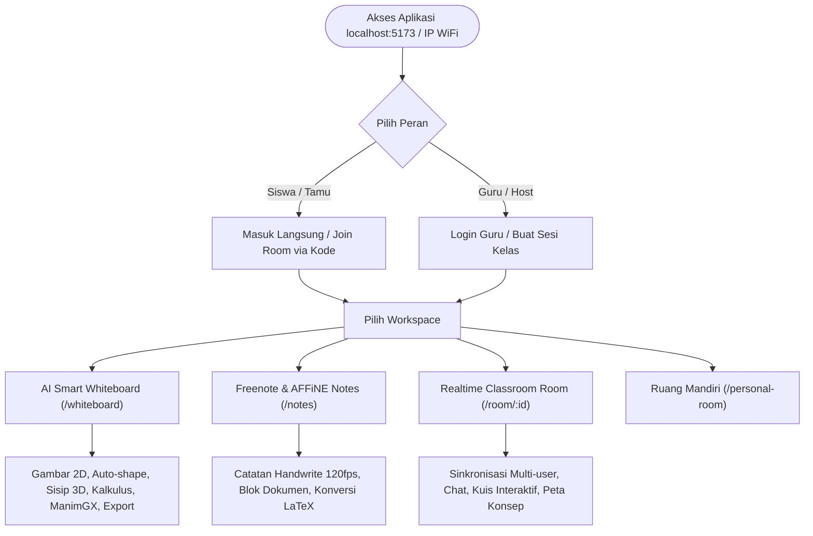

# Panduan Alur Aplikasi & Katalog Fitur QA Testing
**Proyek:** AI Interactive Classroom  
**Target:** Tim QA, Pengembang, & Penguji Lapangan  
**Versi:** V8 Suite (Smart Whiteboard + 3D Solid Studio + Notes/AFFiNE + Realtime Classroom)

---

## 1. Arsitektur & Gambaran Umum Aplikasi

Aplikasi **AI Interactive Classroom** adalah platform ruang kelas interaktif cerdas modern berbasis web (PWA) yang menggabungkan:
1. **AI Smart Whiteboard (Infinite Canvas)** dengan rendering akselerasi Konva + Three.js 60fps.
2. **2D & 3D Math Studio** (Auto-recognition, pembedahan bangun ruang, jaring-jaring 3D, irisan bidang, ManimGX animasi visual, formula kalkulasi).
3. **Smart Notes & Block Document** (Freenote Ink stylus & AFFiNE / BlockSuite doc & board hybrid).
4. **Realtime Multi-user Classroom** berbasis Laravel Reverb WebSocket + Redis.
5. **Mobile-First & PWA Support** (dukungan stylus, responsive toolbar, pinch-to-zoom tanpa glitch).

---

## 2. Alur Pengguna (User Journeys)



### Alur 1: Alur Guru Mengajar Matematika 2D/3D di Whiteboard
1. Buka `/whiteboard`.
2. Guru menggambar garis persegi panjang bebas (atau goresan patah L).
3. Klik kanan objek atau seleksi goresan → pilih **🔗 Gabung Bangun 2D** atau langsung **🧊 Ubah ke Bangun Ruang 3D**.
4. Muncul dialog pemilihan bangun ruang (Balok, Kubus, Prisma, Limas, dsb).
5. Objek 3D interaktif muncul di canvas. Guru dapat:
   - Memutar (orbit), rotasi bebas 360°, atau snap ke preset kamera (Depan, Atas, Samping, Isometrik).
   - Membuka jaring-jaring bangun ruang (Unfold Slider).
   - Melakukan irisan bidang (Cross-section) dengan slider atau 3 titik potong.
   - Menggeser posisi objek 3D dengan tombol `✋ Geser` secara mulus tanpa loncat.
6. Klik menu **Rumus / Kalkulasi** untuk memunculkan kartu perhitungan volume/luas permukaan otomatis.

### Alur 2: Alur Catatan Kuliah / Sekolah (Handwriting & Docs di Mobile/Desktop)
1. Buka `/notes` melalui browser laptop atau HP via alamat IP WiFi (`http://<ip-laptop>:5173/notes`).
2. Tab **Freenote Ink**:
   - Menulis bebas dengan stylus/jari dengan latensi minimal (120fps canvas).
   - Menulis huruf beraksen/titik (misal huruf `i`, `j`, titik angka) terdeteksi presisi.
   - Zoom in / Zoom out dengan pinch gesture tanpa distorsi teks atau garis loop ganda.
   - Konversi tulisan tangan matematika menjadi formula LaTeX otomatis.
3. Tab **AFFiNE Doc & Board**:
   - Mode dokumen blok untuk mengetik silabus, materi kuliah, checklist soal latihan.
   - Papan catatan visual kanban/kartu.

### Alur 3: Alur Kolaborasi Kelas Realtime
1. Guru membuat ruangan kelas di `/room/new` dan membagikan kode ruangan atau link QR Code.
2. Siswa membuka ruangan melalui HP atau laptop masing-masing.
3. Setiap coretan, pembuatan objek geometri, teks, dan laser pointer tersinkronisasi realtime ke semua peserta melalui WebSocket.
4. Guru dapat mengunci canvas, meluncurkan kuis interaktif, atau membuka asisten AI pembelajaran.

---

## 3. Matriks Fitur & Skenario Pengujian QA (Checklist)

### Modul A: AI Smart Whiteboard (`/whiteboard`)

| ID Test | Fitur / Komponen | Skenario Pengujian | Hasil yang Diharapkan (Pass Criteria) |
| :--- | :--- | :--- | :--- |
| **QA-WB-01** | Tool Pena & Auto-shape | Buat bentuk lingkaran/kotak/segitiga dengan pena bebas. | Garis mulus; jika mode auto-shape aktif, bentuk bebas otomatis snap menjadi geometri presisi. |
| **QA-WB-02** | Penggabungan Garis Patah (Merge to 2D) | Gambar 2 garis patah berbentuk huruf "L" yang membentuk persegi panjang. Blok kedua garis → klik kanan → pilih **🔗 Gabung Bangun 2D**. | Kedua garis menyatu menjadi satu objek persegi panjang `rect` yang utuh dan rapi. |
| **QA-WB-03** | Konversi Langsung Garis ke 3D | Gambar garis/goresan geometri patah, seleksi, lalu klik **🧊 Ubah ke Bangun Ruang 3D**. | Garis otomatis ter-merge dan modal dialog bangun 3D langsung terbuka untuk memilih Balok/Kubus/dll. |
| **QA-WB-04** | Geser Objek 2D (Pan & Drag) | Pilih objek geometri atau goresan di whiteboard dengan tool Seleksi atau Tangan (`Hand`), lalu seret mouse/jari. | Objek bergeser secara halus (60fps) tanpa stutter/patah-patah dan tersimpan saat pointer dilepas. |
| **QA-WB-05** | Solid 3D Drag (`✋ Geser`) | Sisipkan bangun 3D (misal Kubus). Klik tombol `✋ Geser` pada header objek 3D, lalu geser ke berbagai arah. | Objek 3D berpindah posisi dengan mulus mengikuti kursor, **TIDAK melompat/glitch ke pojok kiri atas**, dan skala zoom tetap konsisten. |
| **QA-WB-06** | Kontrol Kamera 3D | Klik tombol kamera preset `Iso`, `Depan`, `Atas`, `Samping`, `360°`, atau orbit dengan mouse di dalam bangun 3D. | Tampilan sudut pandang 3D berputar halus sesuai sudut pandang yang dipilih. |
| **QA-WB-07** | Jaring-jaring 3D (Unfold) | Pada objek 3D (Kubus/Balok/Prisma), aktifkan mode **Jaring** dan geser slider lipatan (0° - 180°). | Bangun ruang membuka menjadi jaring-jaring datar 2D secara bertahap dan dapat dilipat kembali. |
| **QA-WB-08** | Irisan Bidang (Cross Section) | Pada objek 3D, pilih menu **Irisan**. Gunakan opsi 3 titik atau slider bidang potong. | Terbentuk bidang potong berwarna dengan visualisasi irisan yang transparan dan akurat. |
| **QA-WB-09** | Salin & Tempel (Copy-Paste) | Seleksi objek 2D atau 3D, tekan tombol **Duplikat / Salin**, atau gunakan shortcut keyboard `Ctrl+C` dan `Ctrl+V`. | Objek baru terduplikasi dengan posisi sedikit offset di sebelah objek asli tanpa merusak data objek lama. |
| **QA-WB-10** | Roda Radial Klik Kanan (Tongchuang Radial Wheel) | Klik kanan pada kanvas kosong, dan klik kanan pada objek terpilih. | Pada kanvas kosong muncul roda aksi tools cepat; pada objek muncul aksi spesifik (Ubah ke 3D, Gabung 2D, Kunci, Duplikat, Hapus, AI Explain). |
| **QA-WB-11** | ManimGX Visual Generator | Buka widget ManimGX, masukkan persamaan matematika atau pilih template (misal lingkaran pusat (2,1)), klik **Plot**. | Grafik kurva/lingkaran ter-render dinamis dengan label koordinat dan card dapat digeser bersama kanvas. |
| **QA-WB-12** | Laser Pointer Mode | Pilih tool Laser (`K`), gerakkan pointer di kanvas. | Jejak laser bercahaya merah/oranye muncul sementara dan memudar perlahan (trail decay) tanpa meninggalkan coretan permanen. |

---

### Modul B: Smart Notes & Mobile View (`/notes`)

| ID Test | Fitur / Komponen | Skenario Pengujian | Hasil yang Diharapkan (Pass Criteria) |
| :--- | :--- | :--- | :--- |
| **QA-NT-01** | Penulisan Titik & Huruf I | Tulis kata dengan titik (seperti "titik", "ini", "i", "j") di atas kertas bergaris/titik-titik. | Titik kecil tetap ter-render presisi dan tidak hilang atau terabaikan oleh smoothing filter. |
| **QA-NT-02** | Zoom In / Out Tanpa Distorsi | Tulis kalimat di layar, lalu gunakan pinch gesture (2 jari) untuk zoom in dan zoom out. | Teks tidak menjadi gepeng/pipih dan tidak muncul garis-garis double/loop di kanvas. |
| **QA-NT-03** | Mode Hand & Geser Kertas | Aktifkan tool Tangan (`Hand`) atau geser kertas catatan saat kanvas diperbesar. | Kertas catatan bergerak stabil mengikuti jari/mouse tanpa menggoreskan tinta baru. |
| **QA-NT-04** | Responsive Toolbar Mobile | Buka `/notes` dan `/whiteboard` di resolusi HP (360px - 412px lebar layar). | Toolbar tampil rapi, ringkas, tidak menumpuk memenuhi layar, dan tombol-tombol utama mudah dijangkau jempol. |
| **QA-NT-05** | Integrasi AFFiNE Doc & Board | Buka tab **AFFiNE Doc & Board**, buat blok teks dan heading. | Dokumen block-suite dapat diketik, diedit, dan diformat dengan cepat sebagai catatan materi pelajaran. |

---

### Modul C: Realtime Classroom & Performa

| ID Test | Fitur / Komponen | Skenario Pengujian | Hasil yang Diharapkan (Pass Criteria) |
| :--- | :--- | :--- | :--- |
| **QA-RT-01** | Multi-device Sync | Buka room kelas yang sama di 2 browser berbeda (atau laptop + HP). Buat coretan di satu sisi. | Coretan dan penambahan bangun muncul di perangkat lain secara instan (< 100ms di jaringan lokal). |
| **QA-RT-02** | Akses Jaringan Lokal (WiFi) | Jalankan dev server dengan opsi host (`--host 0.0.0.0`), lalu buka IP komputer dari HP yang terhubung ke satu WiFi. | Halaman terbuka sempurna, PWA prompt aktif, dan dapat digunakan normal. |
| **QA-RT-03** | Kinerja Memori & FPS | Buat lebih dari 50 objek dan 3 bangun ruang 3D sekaligus, lalu gerakkan kanvas. | Framerate kanvas tetap terjaga stabil di kisaran 60fps tanpa memory leak atau tab crash. |

---

## 4. Panduan Menjalankan Pengujian Teknis (Automated QA Commands)

Bagi tim QA yang ingin memverifikasi kode secara otomatis sebelum rilis:

```bash
# 1. Typecheck TypeScript (Memastikan tidak ada error tipe data)
./apps/web/node_modules/.bin/tsc -p apps/web/tsconfig.json --noEmit

# 2. Jalankan Unit Tests Vitest (Termasuk test penggabungan stroke)
cd apps/web && ./node_modules/.bin/vitest run src/lib/mergeStrokesToShape.test.ts

# 3. Build Produksi Vite
./apps/web/node_modules/.bin/vite build apps/web
```

---

## 5. Ringkasan Tombol Cepat (Keyboard Shortcuts) untuk QA

- `V` : Tool Seleksi (Mouse Pointer)
- `H` : Tool Tangan (Hand / Pan Canvas)
- `P` : Pena Gambar Bebas
- `E` : Penghapus (Eraser)
- `K` : Laser Pointer
- `G` : Gabung Bangun 2D (saat 2+ garis/objek dipilih)
- `Ctrl + Z` : Undo
- `Ctrl + Y` / `Ctrl + Shift + Z` : Redo
- `Ctrl + C` / `Ctrl + V` : Copy / Paste Objek
- `Delete` / `Backspace` : Hapus Objek Terpilih
- `Klik Kanan` : Membuka Tongchuang Radial Wheel Menu
